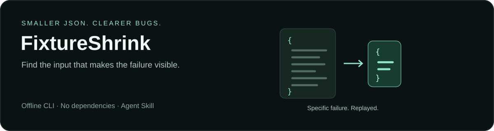

# FixtureShrink

**Make the failing JSON smaller. Keep the failure reproducible.**

Large fixture, obscure bug, too much irrelevant data. FixtureShrink removes JSON object members and array chunks, then reruns your existing test command to check that the intended failure still appears.

A portable **Agent Skill** with an optional **zero-dependency Node.js CLI**. No service, API key, or model download is needed by the helper.

**[Download the skill](https://github.com/ScriptNegative/fixture-shrink/releases/latest) · [See the recorded run](evals/results.md) · [CLI reference](skills/fixture-shrink/references/cli.md)**

## Try it in 30 seconds

With Node.js 18 or later, clone this repository and run from its root:

```sh
git clone https://github.com/ScriptNegative/fixture-shrink.git
cd fixture-shrink
node skills/fixture-shrink/scripts/shrink.mjs examples/catalog/input.json --oracle examples/catalog/oracle.json --out catalog-repro --max-runs 200
```

Open `catalog-repro/reduced.json` and `catalog-repro/report.md`, then replay it:

```sh
node examples/catalog/check.mjs catalog-repro/reduced.json
```

The demo deliberately loses a product when two distinct SKUs are indexed under the same normalized key. The checker prints `REPRO: normalized-sku-collision` and exits with code 1. Other validation errors also exit with 1, but have a different signature and are rejected by the reducer.

This is a planted, reproducible example — not a production incident or a performance benchmark. Your run's report contains the actual sizes, oracle attempts, and outcome.

In the recorded local run, **34 products / 13,548 bytes became 2 products / 235 bytes** after 81 oracle invocation attempts. Both final replays produced the target signature. [Evidence and limitations](evals/results.md).

## What you get

| Before | After a verified run |
| --- | --- |
| A bulky JSON fixture that triggers an error | A smaller candidate that replayed the specified failure twice |
| A broad “the test failed” signal | An explicit exit code and selected output fragment |
| Manual deletion with an uncertain stopping point | A bounded search and a record of actual attempts |

- **Preserve the failure you mean.** Require both the configured exit code and a distinctive substring on stdout or stderr.
- **Keep required values.** Pin JSON pointers such as `/schemaVersion`.
- **Bound repeated work.** Limit oracle invocation attempts, per-run time, and captured output.
- **Review the evidence.** Baselines, accepted reductions, and final replays are recorded locally.

## Use it with an agent

Copy the complete [`skills/fixture-shrink`](skills/fixture-shrink) folder into your host's skill directory. Keep its scripts and reference together.

| Host | Typical project-local location |
| --- | --- |
| Codex | `.agents/skills/fixture-shrink/` |
| Claude Code | `.claude/skills/fixture-shrink/` |
| Other Agent Skills hosts | The skill directory documented by that host |

Host loading and invocation differ; a compatible folder format does not guarantee that every chat product can execute local programs. The CLI also works without a skill loader.

Example request:

> Use FixtureShrink to reduce `fixtures/failing-response.json`. The existing checker is `node tests/check-response.mjs <input>`. Preserve the `REPRO: duplicate-event` failure and `/schemaVersion`. Keep the source fixture unchanged and report the actual reduction and replays.

The skill asks the agent to establish a precise oracle first, reduce the fixture, then explain what the evidence supports.

## Bring your own failure

Create an oracle file:

```json
{
  "command": ["node", "tests/check-response.mjs", "{input}"],
  "expect": {
    "exit_code": 1,
    "stream": "stderr",
    "includes": "REPRO: duplicate-event"
  },
  "timeout_ms": 3000,
  "max_output_bytes": 65536,
  "preserve": ["/schemaVersion"]
}
```

Exactly one command argument is the standalone `{input}` placeholder. Commands use an argument array and run without a shell. Run from the directory expected by your command; choose a new output directory for every reduction.

```sh
node skills/fixture-shrink/scripts/shrink.mjs fixtures/failing-response.json --oracle oracle.json --out response-repro --max-runs 80
```

The oracle is your own program and runs with your permissions. Prefer a local, read-only test. Repeated executions can have side effects if your program writes files or calls services; the helper provides no isolation.

## How acceptance works

The original bytes must match twice, using a copy at the candidate path. Their normalized JSON representation must also match twice. Every accepted candidate must match twice, and two further runs verify the final result before `reduced.json` is written. A timeout, failure to start the command, or output overflow is never treated as an interesting failure.

The run cap includes these checks. At the minimum of six runs, there is room for baselines and final verification only. A run can exhaust its budget and still return a verified partial reduction; inspect `report.md` for the outcome.

## Scope and limits

FixtureShrink deletes structure; it does not change scalar values, reduce source code, or discover a root cause. A matching output fragment is only as specific as your oracle. Repeated checks catch some flaky behavior, but cannot prove determinism or global minimality. The oracle must accept an arbitrary candidate path; filename-sensitive failures need a suitable wrapper.

Input is limited to 1 MiB of UTF-8 JSON. Parsing and serialization normalize whitespace and duplicate keys. Unsafe integer values and nonfinite numeric results are rejected. Use a different reducer for formatting-sensitive JSON parser bugs. Reduced fixtures and reports may still contain secrets; inspect them before sharing.

See the [full CLI reference](skills/fixture-shrink/references/cli.md), [existing alternatives](docs/alternatives.md), and [catalog example](examples/catalog).

## Contribute

Useful contributions include tricky JSON fixtures, clearer failure oracles, cross-platform fixes, and reduction cases that stop too early. Include a small, redacted reproducer, the command you ran, and the report. State whether a failure is deterministic and remove credentials, personal data, and proprietary data before submitting it.

Test-case reduction has a long history. [JS Delta](https://github.com/wala/jsdelta), [Shrink Ray](https://github.com/DRMacIver/shrinkray), and [Picire](https://github.com/renatahodovan/picire) offer broader or different capabilities. FixtureShrink focuses on a small, reviewable JSON workflow for coding agents and local use.

MIT licensed. Built by [ScriptNegative](https://github.com/ScriptNegative).
